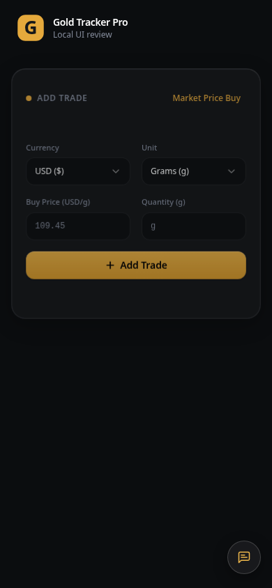
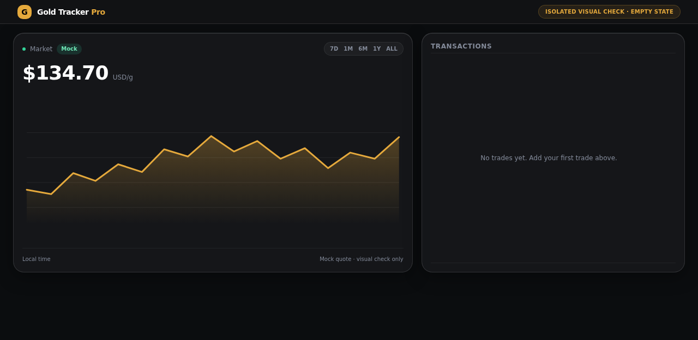
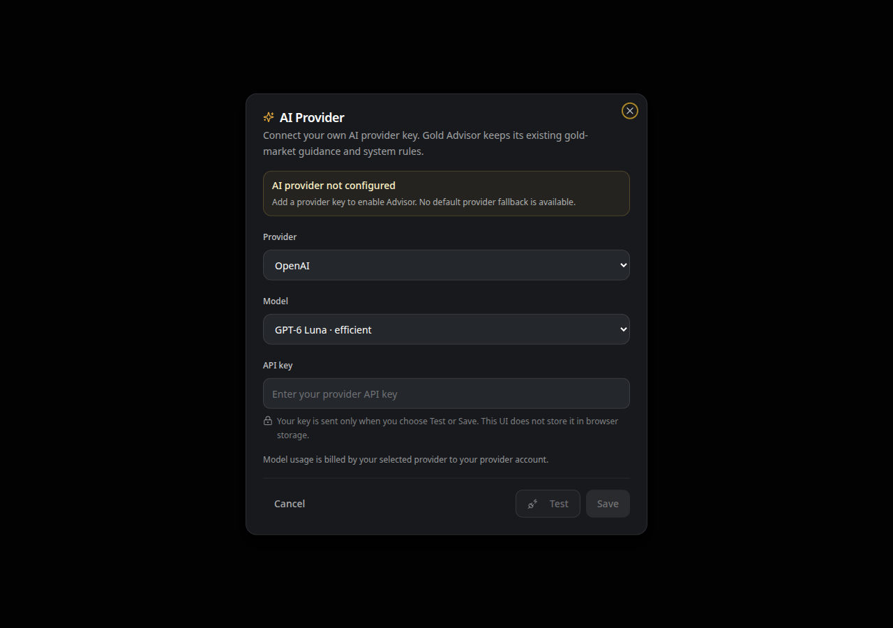

# Gold Tracker Pro

Gold Tracker Pro is a responsive personal gold-portfolio tracker. Record gold purchases and review holdings, costs, estimated value, and portfolio performance. The app records trades; it does not execute them.

## Features

- Record dated gold purchases with price, weight, and currency; enter weight in grams or ounces, or quick-fill the current quote.
- Review portfolio quantity, total invested, average cost, estimated current value, unrealized profit/loss, and return.
- Inspect transaction history, including transaction-level value and P&L; deleted transactions can be undone.
- Follow gold-price history with 7D, 1M, 6M, 1Y, and ALL chart ranges, manual refresh, and a freshness indicator.
- Choose a display currency and weight unit.
- Use English or Simplified Chinese.
- Sign in with email/password or Google OAuth.
- Open Gold Advisor, a gold-market-focused chat feature. It requires a user-supplied API key from OpenAI, Anthropic, or Google Gemini; there is no shared/default provider key. Provider usage is billed to the user by their provider.

Supported display currencies are USD, MYR, CNY, EUR, and SGD. Gold quotes are displayed in USD per gram after conversion from a troy-ounce price.

## Screenshots







## Tech stack

- React 18, TypeScript, and Vite
- Tailwind CSS with Radix and shadcn-style UI components
- Lightweight Charts
- Supabase Auth, Postgres, and Edge Functions

## Getting started

### Prerequisites

- Node.js and npm
- A configured Supabase project

### Install dependencies

```bash
npm ci
```

### Configure local environment

Create `.env.local` with your Supabase project URL and publishable key:

```dotenv
VITE_SUPABASE_URL=your_supabase_project_url
VITE_SUPABASE_PUBLISHABLE_KEY=your_supabase_publishable_key
```

Use your own project values. Never commit `.env`, `.env.local`, credentials, or other secrets. There is no `.env.example` yet; add a template containing placeholder values before publishing.

### Run locally

```bash
npm run dev
```

### Run checks

```bash
npm test
npm run lint
npm run build
```

Use `npm run preview` to preview a production build locally.

## Supabase deployment

The two browser environment variables are not enough for a complete deployment. Configure the Supabase project, database migrations, authentication providers (including Google OAuth if offered), Edge Functions (`yahoo-finance`, `gold-advisor-provider`, and `gold-advisor-chat`), and required server-side secrets. The Gold Advisor BYOK backend has not yet been deployed and runtime-tested; do not present the production Advisor as available until that work is complete and verified.

## Market and currency data

Gold quote and chart-history data come from Yahoo Finance `GC=F` (COMEX gold futures). TradingView `TVC:GOLD` is used as a fallback for the current quote. The app polls the quote every 10 seconds and marks it stale after 30 seconds. Polling does not guarantee the upstream provider has published a new quote, and the quote is not guaranteed to be real-time spot pricing.

Foreign-exchange rates for CNY, EUR, MYR, and SGD per USD come from `@fawazahmed0/currency-api` via jsDelivr, with `latest.currency-api.pages.dev` as a fallback. The app polls every 30 seconds. If retrieval fails, hard-coded fallback rates are used and marked stale; upstream publication timing may vary.

## Known limitations

- Quotes and conversions may be delayed, stale, or unavailable. Verify prices independently before relying on them.
- Gold Tracker Pro is for informational tracking only; it is not financial advice and does not execute trades. Investing in gold involves risk.
- Gold Advisor requires the user to configure a supported provider key. Model usage is billed by the selected provider; no shared/default key is available. The BYOK backend needs deployment and runtime verification before the feature can be presented as production-ready.
- No license has been selected, and the repository currently has no `LICENSE` file. Choose and add the intended license before publishing.

## Contributing

Issues and pull requests are welcome. For larger changes, open an issue to discuss the proposal first. Include steps to reproduce bugs, and remove secrets or personal data from logs and screenshots.

## License

Not yet selected. This repository currently has no `LICENSE` file.
